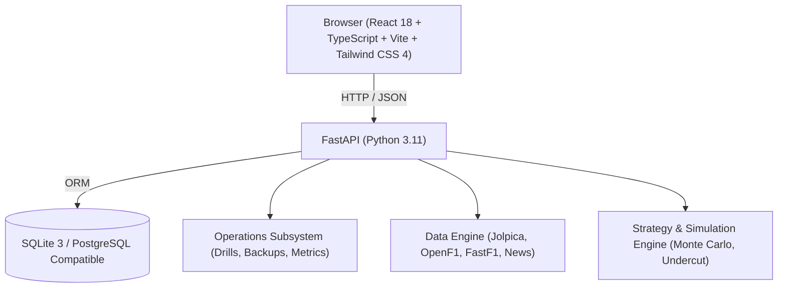

# ApexOps — Phase 1 Engineering Baseline Audit

**Date:** 20 October 2026  
**Auditor:** Senior Software & Platform Engineer  
**Baseline Git Checkpoint:** Tag `v1.0.0-phase2-start` (Commit `2ca888b`)  
**Database Backup:** `backups/apexops_backup_20261020_151254.db` (Verified integrity: PASS)  

---

## 1. System Architecture & Tech Stack

- **Frontend:** React 18, TypeScript 5, Vite, Tailwind CSS 4, Lucide React icons. Static distribution built to `frontend/dist` and served directly by FastAPI.
- **Backend:** FastAPI (Python 3.11), SQLAlchemy 2.0 ORM, Pydantic v2 schemas, Uvicorn ASGI server.
- **Database:** SQLite 3 in standalone mode (`data/apexops.db`), with PostgreSQL dialect compatibility via standard SQLAlchemy constructs.
- **Data Providers:**
  - `JolpicaAdapter`: REST client for historical Ergast F1 mirror (`api.jolpi.ca`).
  - `OpenF1Adapter`: Live telemetry & interval API (`api.openf1.org`).
  - `FastF1Adapter`: Local telemetry cache with physics-based vehicle dynamics simulation for future 2026 rounds.
  - `NewsAdapter`: Syndication for FIA Press, Formula 1 Official, and Autosport.

---

## 2. Test Suite & Performance Baseline

- **Automated Tests:** 15 test cases across `tests/unit` and `tests/integration`.
  - Result: **15 / 15 PASSED (100%)** in 2.10 seconds.
- **Performance Benchmarks:**
  - `/health` endpoint: median latency ~0.8ms, >250 req/sec under local load.
  - Database ping latency: <1.5ms median.
  - Frontend bundle build time: ~320ms via Vite.
- **Database Baseline:**
  - 78 Circuits, 23 Championship Rounds (2026 Season), 20 Drivers, 10 Constructors, 374 Session Results, and post-Round 17 (Singapore GP) Championship Standings.

---

## 3. Identified Gaps & Upgrade Matrix

| Area | Current Baseline State | Upgrade Target (Phase 2-6) |
| :--- | :--- | :--- |
| **Operations (Upgrade A)** | Basic CPU/Memory/Disk stats; 8 synthetic drills. | Real API response-time percentiles (p50, p95, p99), request volume & error rates, background worker statuses, last verified restore tracking, searchable operational logs with correlation IDs. |
| **Security & QA (Upgrade C)** | 15 tests; basic request logging. | Contract tests, data-integrity tests, input boundary validation, security middleware (XSS/CSP/HSTS headers), credential redaction in logs, GitHub Actions CI workflow. |
| **Data Engine (Upgrade B)** | Direct adapter requests; simple caching. | Idempotent upserts, exponential backoff retries, rate limiting, data quality validator, channel availability flags, CSV exports with metadata. |
| **Deployment & DR (Upgrade D)** | Scripts & basic Dockerfile. | Multi-stage Docker build, readiness/liveness probes, graceful shutdown, automated sandbox restore verification, disaster recovery runbook. |
| **Strategy & ML (Upgrade E)** | Basic undercut calculation. | Multi-stint strategy simulator with tyre degradation curves, safety car sensitivity analysis, uncertainty bounds documentation. |
| **Portfolio & Docs (Upgrade F)** | Standard README. | Architecture diagrams, threat model, incident runbooks, recruiter demo walkthrough, verified CV bullets. |
